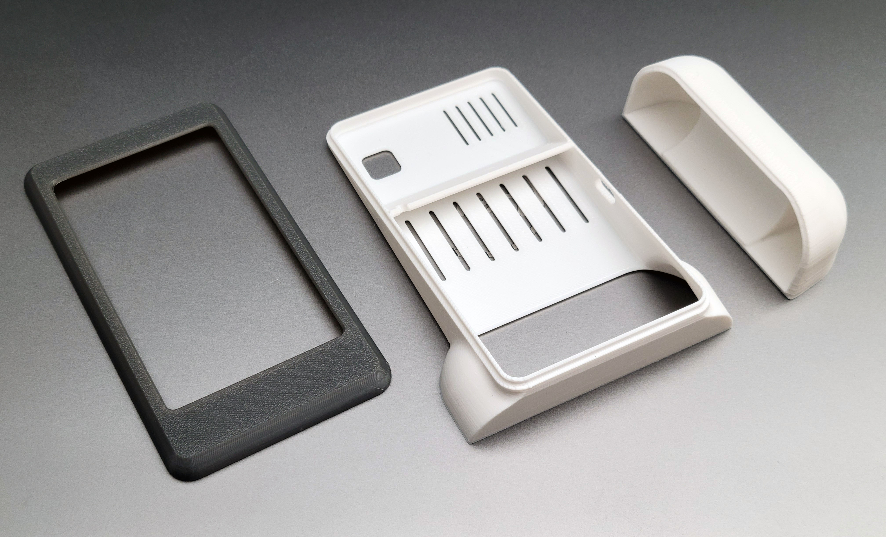
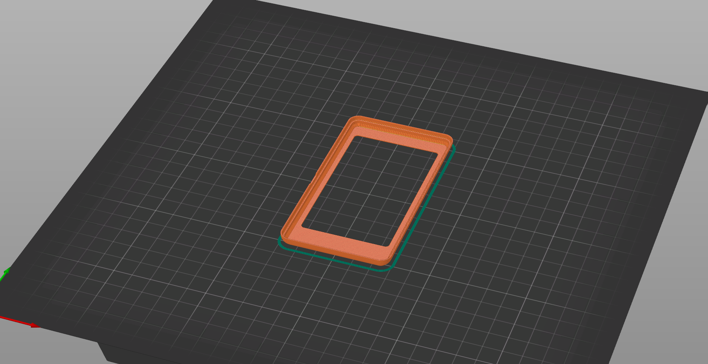
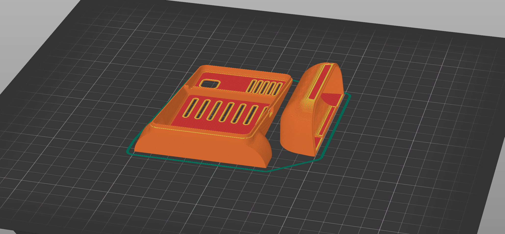

# Mechanical — Enclosure Files

3D-printable enclosure for the battery-powered environmental sensor.

---

## Files

| File | Format | Description |
|------|--------|-------------|
| `Front Lid.3mf` | 3MF | Front cover of the enclosure (display face) |
| `Back Lid.3mf` | 3MF | Back cover — **contains two separate parts in a single file**: the main back panel and the battery access/retention piece. Split them in your slicer before slicing. |
| `Desktop Assembly v3.step` | STEP | Full assembly in neutral CAD format — import into any CAD package (Fusion 360, FreeCAD, SolidWorks, etc.) to inspect, modify, or take measurements |
| `Desktop Assembly.f3z` | Fusion 360 Archive | Native Fusion 360 source file for the full assembly |

---

## Printing

### Material & Color

The enclosure was printed in **PETG**, though you should be fine to print in PLA if desired:

- **Front Lid** — grey PETG
- **Back Lid** (both parts) — white PETG

### Orientation

Print each part as shown in the orientation photos below. Correct orientation avoids support material on visible faces and ensures the best surface finish on the exterior sides.

**Front Lid**

**Back Lid**

### Recommended Settings

- Layer height: 0.15-0.20 mm
- Walls: 3–4 perimeters
- Infill: 15–20% (gyroid or cubic)
- Supports: orient parts as shown above to avoid needing supports

---

## Adding a Textured Surface

A matte or textured exterior finish looks great on this enclosure and helps hide minor print artefacts. Two easy approaches:

1. **Slicer texture/skin** — PrusaSlicer, Bambu Studio, and Orca Slicer all support applying a fuzzy skin or textured top surface directly in the slicer settings. Enable *Fuzzy Skin* on the outer perimeters for a soft, tactile finish.

2. **Mesh bump mapping** — Import the STL into [bumpmesh.com](https://bumpmesh.com) to bake a displacement texture (carbon fiber, leather, hexagons, etc.) directly onto the mesh surface before slicing.
