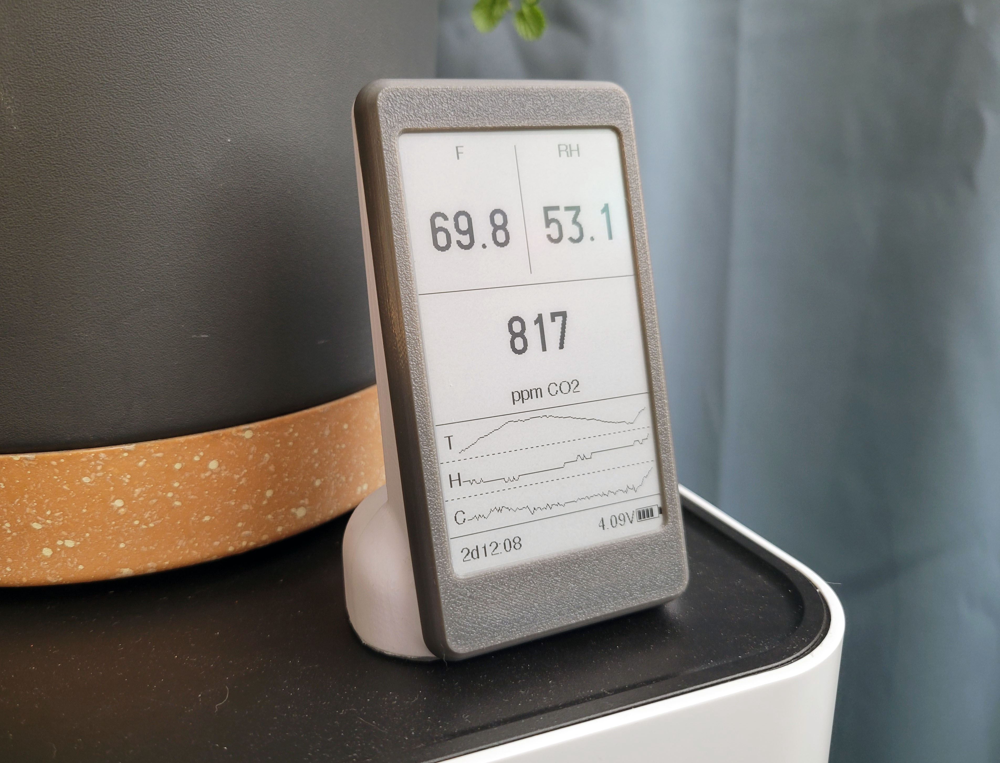
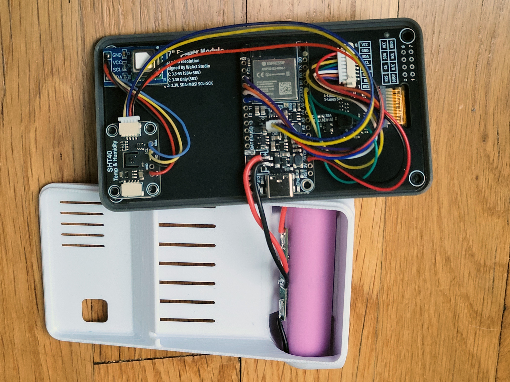

# Battery Environmental Sensor



A battery-powered, 3D-printed indoor air quality monitor. The device wakes on a ~2.5-minute duty cycle, reads CO₂, temperature, and humidity, updates a 3.7" e-paper display, and publishes sensor data to Home Assistant over MQTT. Between cycles it enters deep sleep to preserve battery life, running up to 20 days on a single charge.

---

## Overview

| | |
|---|---|
| **MCU** | Adafruit ESP32-S3 Feather (2MB PSRAM) |
| **Sensors** | Sensirion SCD41 (CO₂, T/H) · Adafruit SHT40 (primary T/H) |
| **Display** | WeAct Studio 3.7" e-paper, 240×416, black & white |
| **Battery** | 3500mAh 18650 Li-Ion via onboard JST connector / MAX17048 gauge |
| **Connectivity** | Wi-Fi → MQTT → Home Assistant auto-discovery |
| **Enclosure** | 3D-printed three-part PETG enclosure |

On each wake the firmware: powers up the sensor rail, fires a two-shot SCD41 warm-up sequence, connects to Wi-Fi (overlapping the sensor warm-up window), reads both sensors, publishes an MQTT JSON payload, conditionally refreshes the display, then returns to deep sleep. History is retained across sleep cycles in RTC SRAM (up to ~5 hours of sparkline data).

---

## Repository Structure

```
├── Firmware/   — Arduino sketch, all source files, config template
├── Mechanical/ — 3MF print files, STEP/Fusion 360 source assembly
└── Docs/
    └── img/    — Reference photos and print orientation guides
```

- [Firmware/README.md](Firmware/README.md) — full firmware architecture, wiring, library list, MQTT topics, display layout, and known quirks
- [Mechanical/README.md](Mechanical/README.md) — enclosure files, print settings, orientation, and texture tips

---

## Hardware Summary

| Component | Part | Notes |
|-----------|------|-------|
| MCU | Adafruit ESP32-S3 Feather #5477 (2MB PSRAM) | Board package: *Adafruit ESP32-S3 Feather* |
| CO₂ + secondary T/H | Sensirion SCD41 | I2C 0x62, STEMMA QT |
| Primary temperature / humidity | Adafruit SHT40 | I2C 0x44, STEMMA QT |
| Display | WeAct Studio GDEY037T03 3.7" e-paper | SPI (SCK=GPIO36, MOSI=GPIO35) |
| Battery gauge | Onboard MAX17048 | I2C 0x36 |
| Battery | 3500mAh 18650 Li-Ion | JST connector on Feather |

---

## Wiring



### I2C — Sensors (STEMMA QT / Qwiic)

Both sensors connect via the Feather's onboard **STEMMA QT connector** and are daisy-chained together using standard Qwiic/STEMMA QT cables — no soldering required.

| Connection | Detail |
|------------|--------|
| Feather STEMMA QT → SHT40 | First cable in the chain |
| SHT40 STEMMA QT out → SCD41 | Second cable, daisy-chained from SHT40 |


| Device | I2C Address |
|--------|-------------|
| SHT40 (primary T/H) | 0x44 |
| SCD41 (CO₂ + secondary T/H) | 0x62 |
| MAX17048 (battery gauge, onboard) | 0x36 |

### SPI — E-paper Display

The display data lines use the Feather's **main SPI bus** (left-side header). Control lines connect to the right-side header.

| Signal | Feather silkscreen | GPIO |
|--------|--------------------|------|
| SCK | SCK (left header) | 36 |
| MOSI | MO (left header) | 35 |
| CS | D10 | 10 |
| DC | D9 | 9 |
| RES | D6 | 6 |
| BUSY | D5 | 5 |
| VCC | 3.3V | — |
| GND | GND | — |

### Power

The 18650 Li-Ion cell connects to the Feather's onboard **JST connector**. The STEMMA QT power rail is switched by the firmware at runtime; the MAX17048 gauge remains powered through deep sleep.

See [Firmware/README.md](Firmware/README.md) for additional wiring detail and pin-definition notes.

---

## Assembly

1. **Solder all connections first** — complete all wire and header soldering before mounting any boards with tape.

2. **Tape the e-ink screen into the front shell** — apply thin double-sided tape to the back face of the e-ink panel and press it into the inside of the 3D-printed front shell. Use regular thin double-sided tape here, not foam VHB — the panel needs to sit flush against the shell with minimal gap.

3. **Mount boards with VHB tape** — the Feather and both sensor breakouts (SHT40, SCD41) are affixed to the back of the e-ink PCB using **3M VHB double-sided foam tape**. VHB provides a strong permanent bond without fasteners.

4. **Minimize tape on heat-sensitive components** — apply tape only where needed for mechanical retention. Covering large areas of the SHT40 or SCD41 conducts heat from the display PCB into the sensor boards and will skew temperature and humidity readings. Use small strips at the board edges where possible.

5. **Use the printed shells for alignment** — before committing to tape placement, dry-fit the PCB stack inside the front and back shells. The enclosure cutouts for the USB connector, battery connector, and any exposed sensors act as alignment guides to ensure everything lines up flush before the tape sets.

---

## Development Environment

### 1. Arduino IDE

Install **Arduino IDE 2.x** from [arduino.cc](https://www.arduino.cc/en/software).

### 2. Board Package

Add the Adafruit board index URL in *File → Preferences → Additional boards manager URLs*:

```
https://adafruit.github.io/arduino-board-index/package_adafruit_index.json
```

Then open *Tools → Board → Boards Manager*, search for **esp32**, and install the **Adafruit ESP32** package. Select **Adafruit Feather ESP32-S3 2MB PSRAM** as the board.

### 3. Libraries

Install all of the following via *Sketch → Include Library → Manage Libraries*:

| Library | Purpose |
|---------|---------|
| `GxEPD2` | E-paper display driver |
| `Adafruit GFX Library` | Font and drawing primitives |
| `U8g2_for_Adafruit_GFX` | U8g2 font bridge |
| `U8g2` | U8g2 font data |
| `Adafruit SHT4x Library` | SHT40 temperature / humidity driver |
| `Sensirion I2C SCD4x` | SCD41 CO₂ driver (Sensirion official, v2 API) |
| `Adafruit MAX1704X` | MAX17048 battery fuel gauge |
| `PubSubClient` | MQTT client |
| `ArduinoJson` | JSON payload builder |

### 4. Configuration

Copy `Firmware/config.example.h` to `Firmware/config.h` (the file is gitignored — never commit credentials):

```
cp Firmware/config.example.h Firmware/config.h
```

Edit `config.h` and fill in:

**Wi-Fi**
```cpp
#define WIFI_SSID       "your-network-name"
#define WIFI_PASSWORD   "your-password"

// Optional static IP (eliminates a ~1s DHCP round-trip on every wake):
#define WIFI_STATIC_IP  1
#define WIFI_IP         "192.168.1.x"
#define WIFI_GATEWAY    "192.168.1.1"
#define WIFI_SUBNET     "255.255.255.0"
#define WIFI_DNS        "192.168.1.1"
```

**MQTT / Home Assistant**
```cpp
#define MQTT_BROKER     "192.168.1.x"   // IP of your broker (e.g. Mosquitto on HA)
#define MQTT_PORT       1883
#define MQTT_USER       ""              // leave empty if no auth
#define MQTT_PASS       ""
#define DEVICE_ID       "envsensor_01"  // unique per device
```

**Sensor tuning** (adjust after physical calibration)
```cpp
#define SCD41_TEMP_OFFSET   4.0f    // °C offset to compensate for self-heating inside enclosure
#define CO2_ALERT_PPM       2000    // triggers underline on CO₂ display zone
```

**Timing** (advanced — defaults are reasonable)
```cpp
#define SLEEP_DURATION_S            155   // seconds between wake cycles
#define DISPLAY_UPDATE_INTERVAL     300   // seconds between e-paper refreshes
#define DISPLAY_FULL_REFRESH_EVERY   10   // full refresh every N updates to clear ghosting
```

### 5. Flash

1. Connect the Feather via USB-C.
2. Select the correct port in *Tools → Port*.
3. Click **Upload** (or press `Ctrl+U`).

On first boot the device publishes five MQTT auto-discovery payloads to Home Assistant, then appears automatically as a device with CO₂, temperature, humidity, battery voltage, and battery percentage entities. Re-discovery is triggered by a hard power-cycle (which clears RTC SRAM).

---

## Home Assistant

No manual YAML configuration is required. Once the device boots and connects to the broker, Home Assistant auto-discovers it via the standard `homeassistant/sensor/<DEVICE_ID>/…/config` retained topics. All five entities are grouped under a single device.

State updates are published each wake cycle to:
```
homeassistant/sensor/<DEVICE_ID>/state
```
```json
{
  "co2": 789,
  "temperature": 69.8,
  "humidity": 28.2,
  "battery_v": 3.62,
  "battery_pct": 74.3
}
```

---

## Enclosure

The three-part 3D-printed enclosure houses the Feather, battery, sensors, and display. See [Mechanical/README.md](Mechanical/README.md) for print files, recommended settings, and orientation guides. Assembly is done by applying cyanoacrylate to the joining areas of the 3 pieces.
